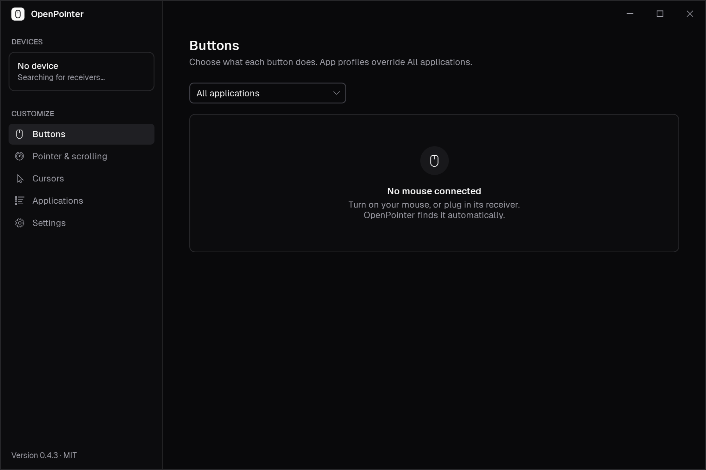
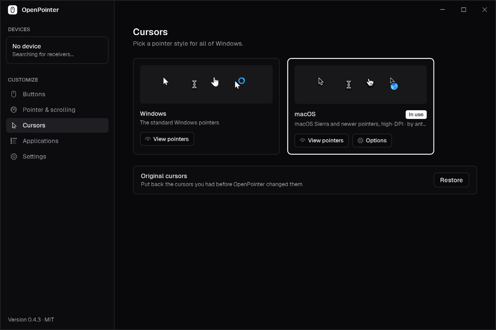
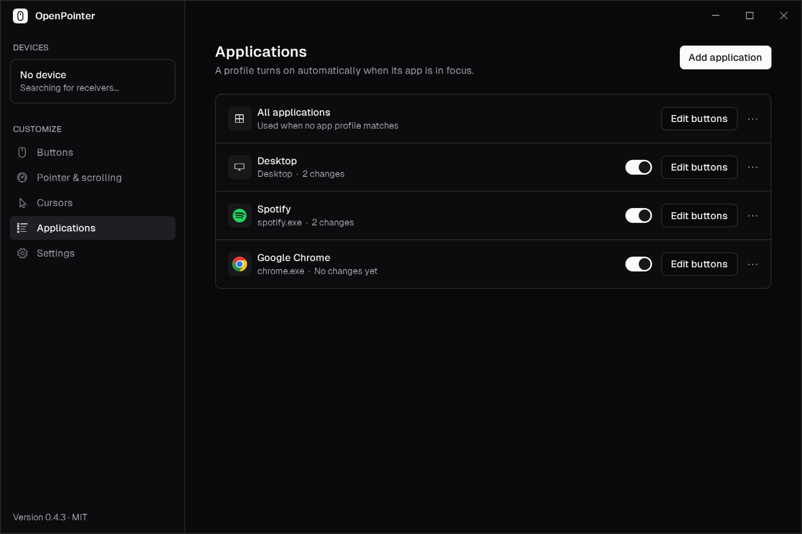

# OpenPointer

**Customize your Logitech mouse on Windows: free, open source, and without Logi Options+.**

Remap any button, per app. Add gestures and an Actions Ring, set pointer speed, change your cursor style, and see your battery level. No account, no cloud, no telemetry.

<table>
  <tr>
    <td></td>
    <td></td>
  </tr>
</table>

## Download

**[Download the latest installer](https://github.com/Manan-Santoki/openpointer/releases/latest)** (`OpenPointer-Setup-x.y.z.exe`) and run it.

- Windows 10 (1809) or newer, 64-bit.
- No admin rights needed. It installs just for you.
- Prefer not to install? Each release also has a portable zip.

Windows may show a SmartScreen warning the first time, because the app isn't code-signed yet. Click **More info → Run anyway**.

## What you can do

### Remap buttons
Give any button a new job:
- keyboard shortcuts
- back/forward, middle click, scrolling
- open an app, file or website
- type text, media and volume keys
- multi-step **macros**

Keys like Volume or the arrow keys **repeat while you hold** the button, just like a keyboard.

### Different buttons for different apps
Make the side buttons go back/forward in Chrome, change the volume in Spotify, and open your favorite apps on the **desktop**. The desktop and the taskbar each get their own profile, separate from File Explorer. Profiles switch the moment you change windows.

### Gestures and the Actions Ring
- **Gestures:** hold a button and move up, down, left or right, or just click. Each one runs its own action.
- **Actions Ring:** hold a button and a circle of up to 8 actions appears around your pointer. Move toward one and let go.

### Pointer and scrolling
- **Pointer speed (DPI)** with presets, and a different speed per app if you like.
- **Scroll speed**, natural scrolling, and smooth scrolling (on mice whose wheel supports it).
- **SmartShift** and ratchet or free-spin wheel modes on MX mice.
- **Thumb wheel** actions and direction.

### Cursor styles
Switch all of Windows between the standard cursors and a **macOS** style, with or without a shadow, in three sizes. Preview every pointer before applying. Your original cursors are saved, and you can restore them any time.

### Battery and quick controls
Battery level is shown in the tray and in the app, and you get a warning when it runs low. Right-click the tray icon to change the current app's buttons, the pointer speed or the wheel mode without opening the window.

## Getting started

1. **Install and open OpenPointer.** It finds your mouse automatically.
2. If **Logi Options+** is running, OpenPointer will offer to stop it. Both apps can't control the buttons at the same time. Options+ stays installed.
3. Open **Buttons**, pick a button and choose an action. Click **Save** to apply.
4. To customize a specific app, open **Applications → Add application**, or use the menu at the top of the Buttons page.
5. For quick changes, right-click the **tray icon** while any app is in front and pick a button.

OpenPointer keeps running in the tray. Close the window and it stays there; choose **Quit** from the tray menu to exit.

## Supported mice

Logitech mice that use the HID++ 2.0 protocol, connected through a **Logi Bolt**, **Unifying** or **Lightspeed** receiver, or **Bluetooth**. That should include most Logitech mice from roughly 2015 onward, such as the MX Master and MX Anywhere series, the Signature series, the M720 and the M585/M590.

OpenPointer reads what your mouse supports and only shows the options it actually has.

**Tested on:** Signature M650 L. If your mouse works (or doesn't), please [say so in an issue](https://github.com/Manan-Santoki/openpointer/issues).

## Updates

OpenPointer checks for new versions automatically. When one is available you'll see a notification, plus **Install update** in the tray menu and in Settings. Updates are verified before they install, and the app restarts by itself. See the [changelog](CHANGELOG.md) for what changed in each version.

## FAQ

**My buttons stopped doing what I set.**
Make sure Logi Options+ isn't running: OpenPointer shows a warning if it is. Also check that remapping isn't paused (tray menu → Pause remapping).

**It doesn't work in some windows.**
Windows doesn't let normal apps send input to apps running as administrator (Task Manager, installers and so on). Remapped buttons won't act on those windows.

**What happens if I quit OpenPointer?**
Your mouse goes back to its normal behavior right away. Remapping only happens while OpenPointer runs.

**Where are my settings?**
In `%APPDATA%\OpenPointer\config.json`. You can back them up or move them to another PC with **Settings → Backup → Export / Import**.

**How do I uninstall?**
Use **Settings → Apps** in Windows. Uninstalling also puts back your original cursors if you changed them.

**Do I still need Logi Options+?**
No, but keep it (or Logitech's Logi Bolt app) if you need to pair a new device to a receiver or update your mouse's firmware. OpenPointer doesn't do those.

## Privacy

OpenPointer works entirely on your PC. It has no account, no analytics and no telemetry. The only network request is the update check, which asks GitHub for the latest release.

## Help and feedback

Found a bug or have an idea? [Open an issue](https://github.com/Manan-Santoki/openpointer/issues). For bugs, attaching your log helps a lot: **Settings → Log → Open log**.

Want to help build it? See [CONTRIBUTING.md](CONTRIBUTING.md).

## License

OpenPointer is free software under the [MIT license](LICENSE).

- macOS cursors by [antiden](https://github.com/antiden/macOS-cursors-for-Windows), MIT.
- Geist font by Vercel, SIL Open Font License.

Not affiliated with or endorsed by Logitech. Logitech, Logi, MX Master and Options+ are trademarks of Logitech.
